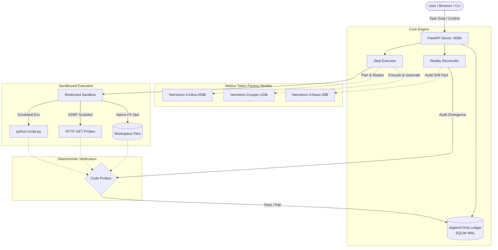

# Saha (सह) — Persistent, Drift-Resilient Personal AI

[](https://github.com/OWNER/REPOSITORY/actions/workflows/ci.yml)
[](LICENSE)
[](https://www.python.org/)
[](https://tokenfactory.nebius.com/)
[](https://build.nvidia.com/)

> **"Your work should never have to start over just because your AI does."**

Saha is an autonomous, state-aware personal AI assistant built for the **Nebius x NVIDIA Global AI Hackathon** (Personal AI Track). 

Unlike chat assistants that lose context or reset their state between sessions, Saha maintains an **append-only ledger** of multi-step task state in SQLite. It executes tasks using strictly sandboxed tools, verifies post-conditions against physical reality using deterministic code probes (never LLM hallucinations), and reconciles reality divergence (drift) without starting over.

---

## Architecture



---

## Model Specialization (Nebius Token Factory)

All model inference routes strictly through `backend/llm.py` via the OpenAI Python SDK pointing to **Nebius Token Factory** (`https://api.tokenfactory.nebius.com/v1/`).

| Role | Nemotron Model Identifier | Specialization | Avg Latency* | Real Token Telemetry* |
| :--- | :--- | :--- | :--- | :--- |
| **PLANNER** | `nvidia/Nemotron-3-Ultra-550b-a55b` | Decomposes high-level goals into DAG steps with dependencies (`depends_on`), tool payloads, and deterministic probe assertions. Replans on reality drift. | **2,817 ms** | 25,472 prompt / 9,715 completion |
| **WORKER** | `nvidia/nemotron-3-super-120b-a12b` | Generates verified file contents, analysis scripts, and performs synthetic workflows inside the task workspace sandbox. | **2,430 ms** | 3,696 prompt / 8,872 completion |
| **FAST** | `nvidia/NVIDIA-Nemotron-3-Nano-30B-A3B` | Synthesizes a factual, 1-sentence drift explanation from structured probe failure data without guessing causes. Runs non-blocking in background. | **5,817 ms** | 827 prompt / 2,004 completion |

*\*Empirical averages recorded directly from 58 real API calls in `llm_calls` SQLite telemetry table during development.*

---

## Key Features

1. **Immutable Append-Only State Machine**:
   - Steps transition strictly: `pending` → `running` → `done` → `verified`.
   - If a step fails physical verification, it is marked `drifted`.
   - **History is preserved forever**: drifted steps are **never** overwritten or deleted; they point to their repair step via `resolved_by`. Dependent steps transition to `superseded` and point to replacement steps via `superseded_by`.
   - A task is complete only when every non-superseded step is `verified`, and every `drifted` step has a verified `resolved_by` step.

2. **Deterministic Reality Probes (Zero LLM Hallucination)**:
   - Verification probes are 100% deterministic code: SHA-256 digests, file existence and size checks, command exit codes, and HTTP status codes.
   - The LLM never evaluates its own success.

3. **Re-Execution Repair Semantics**:
   - On drift reconciliation, Saha **re-executes the repair step** in the workspace environment rather than attempting a byte-exact file restoration. This guarantees the reconstructed state is alive, reproducible, and verifiable.

4. **Non-Blocking Drift Explanation**:
   - Reconciling reality records the deterministic probe failure reason immediately.
   - The FAST Nano-30B model generates a user-friendly 1-sentence audit summary asynchronously in a background thread (with a 15-second timeout fallback to deterministic reason).

---

## Quickstart

### 1. Prerequisites
- Python 3.11+
- A Nebius Token Factory API key (`NEBIUS_API_KEY`)

### 2. Setup Virtual Environment
```bash
git clone https://github.com/OWNER/saha.git
cd saha

python -m venv .venv
# Linux / macOS
source .venv/bin/activate
# Windows PowerShell
.venv\Scripts\Activate.ps1

pip install -r requirements.txt
```

### 3. Configure Environment
Create `.env` in the project root (never commit this file):
```env
NEBIUS_API_KEY=your_nebius_api_key_here
SAHA_PUBLIC_MODE=false
SAHA_DEMO_MODE=true
```

### 4. Run the API Server & Web UI
```bash
uvicorn backend.api:app --host 127.0.0.1 --port 8000
```
Open your browser to `http://127.0.0.1:8000`.

### 5. Run via CLI
```bash
# Execute directly through CLI engine
python -m cli.saha "Create two small data files with facts about Hyderabad, combine them into a summary, and check example.com"
```

### 6. Run Unit & Regression Tests (Offline / No Key Needed)
The entire test suite runs offline without calling the real API or requiring a `NEBIUS_API_KEY`:
```bash
pytest -v
```

---

## Live Demonstration Walkthrough

You can test Saha's drift resilience in 4 simple steps:

1. **Create a Task**: In the Web UI, click the example chip: *"Hyderabad facts summary & reachability check"*, then click **Plan & Create**.
2. **Execute Task**: Click **Run Task**. Saha invokes the `WORKER` model to create `facts1.txt`, `facts2.txt`, combine them into `summary.txt`, and check external HTTP reachability. All steps turn `[VERIFIED]`.
3. **Simulate Reality Drift ("Sabotage")**: Click **Simulate Drift**. The server deletes `facts1.txt` directly from the task workspace on disk without touching the database ledger.
4. **Resume & Reconcile**: Click **Resume & Reconcile**:
   - Saha re-probes physical reality: `facts1.txt` probe fails.
   - Step 1 is marked `[DRIFTED]` (preserved in ledger).
   - Step 3 (which depends on Step 1) is marked `[SUPERSEDED]`.
   - Step 2 and Step 4 remain `[VERIFIED]`.
   - FAST model produces a 1-sentence explanation of what diverged.
   - PLANNER model appends Step 5 (repair for Step 1) and Step 6 (replacement for Step 3).
   - WORKER re-executes pending repair steps and deterministic probes confirm reality. Task reaches `COMPLETE`.

---

## Security Architecture

Saha is engineered with defensive sandbox boundaries:

1. **Path Traversal Sandboxing**:
   - All workspace paths are resolved strictly against `workspace/<task_id>`.
   - Rejects `..`, absolute paths (`/etc/passwd`, `C:\Windows`), UNC paths (`\\server\share`), drive-relative paths (`C:foo`), and symlink escapes.
2. **Subprocess Isolation**:
   - Removed all `shell=True` invocation. No `cmd.exe`, `powershell.exe`, or `bash` execution.
   - Only native Python implementations for `ls`, `cat`, `head`, `tail`, `grep`, and `echo`.
   - Single isolated execution capability: `python script.py` strictly targeting scripts within the task workspace sandbox.
   - Arguments containing shell metacharacters (`;`, `|`, `&`, `>`, `<`, `$`, `` ` ``) are rejected.
3. **Environment Scrubbing**:
   - Child execution processes receive a scrubbed environment containing only bare minimum system paths (`SYSTEMROOT`, `PATH`, `TEMP`).
   - `NEBIUS_API_KEY` and all `.env` secrets are strictly stripped before spawning any child process.
4. **SSRF Defense (`http_get`)**:
   - Rejects IPv4 private ranges (`10.0.0.0/8`, `172.16.0.0/12`, `192.168.0.0/16`), loopback (`127.0.0.0/8`), link-local metadata endpoints (`169.254.0.0/16`), and IPv6 equivalents (`::1`, `fe80::/10`).
   - Re-evaluates target IP on every HTTP redirect.
   - Size capped at 64 KB with a strict 10-second timeout.
5. **Public Mode Safeguards**:
   - Max goal length capped at 300 characters.
   - In-memory IP rate limiter (10 task creations per hour per IP).
   - Domain allowlist restriction (`SAHA_HTTP_ALLOWLIST`).
   - Generic 500 responses with zero path leakage or stack traces.
6. **Honest Limitations**:
   - **DNS Rebinding**: While IP resolution is checked pre-flight, a malicious DNS server altering records between DNS resolution and HTTP socket connection (TOCTOU) remains an inherent limitation of application-level validation. Production hardening would mandate network-layer egress proxies or patched transport adapters.

---

## Deployment

### Docker Deployment
```bash
# Build the container image
docker build -t saha:latest .

# Run container with external environment file and persistent data volume
docker run -d \
  --name saha \
  -p 8080:8080 \
  --env-file .env \
  -v saha_data:/data \
  saha:latest
```

The container runs as non-root user `appuser:appgroup` (UID 10001) and includes an automated healthcheck on `/health`.
A mounted host volume bound to `/data` must be writable by UID 10001 (`chown -R 10001:10001 /path/to/host/data`) or the container must be started as root (`docker run -u root ...`) so `docker-entrypoint.sh` can automatically fix ownership before dropping privileges to `appuser` via `gosu`.

When `SAHA_REQUIRE_PERSISTENT=true` is set, Saha strictly enforces that the configured data storage is persistent and writable. If the data volume cannot be written or points to ephemeral temporary storage, the application immediately aborts startup with an informative error rather than silently risking data loss.

### Render Blueprint Deployment
Deploy Saha directly to [Render](https://render.com) using the included [render.yaml](render.yaml) blueprint:
1. Connect your repository to Render.
2. Select **Blueprints** and choose `render.yaml`.
3. Provide your `NEBIUS_API_KEY` in the environment settings prompt.
4. Render automatically provisions a 1GB persistent disk at `/data`, mounts the container, and verifies health via `/health`.

---

## Limitations & Roadmap

We are candid about Saha's current scope and future trajectory:
- **Cross-Device Ledger Synchronization**: Current ledger is backed by local SQLite WAL. Cloud ledger sync (CRDTs / Postgres replication) across mobile and desktop nodes is planned.
- **Always-On Background Daemon**: Currently execution is session- or user-triggered. An autonomous heartbeat runner with cron scheduling and webhook triggers is future work.
- **Call Triage & Multi-Agent Workforce**: Saha currently focuses on single-agent planner/worker/auditor coordination. Hierarchical multi-agent delegation and autonomous call triage will be added in v2.0.

---

## License

MIT License. See [LICENSE](LICENSE) for details.
